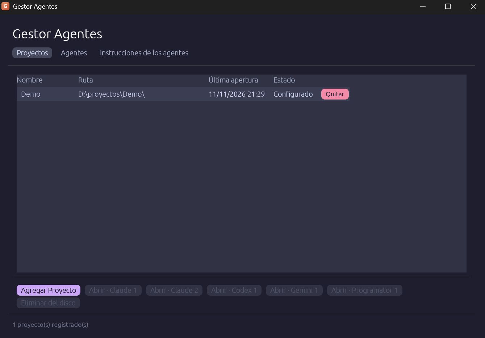

Gestor Agentes

Gestor Agentes es una aplicación de escritorio para Windows y Linux que guarda la lista de tus proyectos de programación y los abre, con un clic, con un agente de inteligencia artificial: Claude Code, Codex, Gemini a través de agy, o Programator. Cada agente se abre en su propia ventana de terminal, ya situado en la carpeta del proyecto y con la cuenta que le corresponde, de modo que puedes tener varias cuentas del mismo agente y varios agentes trabajando a la vez en el mismo proyecto.

Antes de abrir el agente, la aplicación deja el proyecto preparado para ese trabajo en común. Escribe AGENTS.md, el archivo de instrucciones que leen todos los agentes, y CLAUDE.md, con el que Claude Code lo carga. Crea una sola vez el archivo propio del proyecto, instrucciones-del-proyecto.md, que nunca vuelve a tocar. Prepara la carpeta .gestor, donde los agentes se dejan mensajes y llevan su diario, y crea el repositorio git si no existe.

La aplicación es portable: no se instala, y su configuración viaja con ella en la carpeta datos, junto al ejecutable. Antes se llamaba Gestor Claude, y la primera vez que se abre en un equipo donde se usó aquella versión copia su configuración sin tocar la original.

Sobre Celtilander

Soy un usuario novel en el mundo de la programación y la IA. He «ayudado a crear» esta app y espero que a alguien le pueda servir para algo... sin más.

Lo que no funciona no lo escondo: está escrito en los defectos conocidos (https://github.com/celtidcs/gestor-agentes/blob/main/documentation/defectos-conocidos.md). Si encuentras algo que no esté ahí, cuéntamelo.

Para realizar esta app he montado un sistema colaborativo y de consenso entre ChatGPT Codex, Claude Code y Gemini Antigravity. Yo puse la idea y dirigía el proyecto, mientras que ellos diseñaban, repartían y verificaban el trabajo. Ningún código fue revisado por el agente que lo había escrito, y una vez terminado todo debía ser aprobado por unanimidad. Hasta que no se conseguía el consenso, no se daba una tarea por concluida. Cuando por algún motivo no se llegaba a un consenso, era yo quien tomaba la decisión final, así que los fallos que pueda haber serán más míos que de ellos.

Saludos a todo el mundo.

Para usarla

Descarga el paquete portable de tu sistema desde la página de versiones publicadas del repositorio, descomprímelo donde quieras y abre gestor-agentes.exe en Windows o gestor-agentes en Linux. Necesitas además al menos uno de los agentes instalado, porque son programas aparte, y conviene tener git. El archivo LEEME.txt del paquete explica los primeros pasos, y el manual de uso, documentation/usage.md, lo explica todo con detalle, incluido cómo instalar cada agente.

Para compilarla

Está escrita en Rust y organizada en un workspace de cargo con tres partes, cada una con una sola responsabilidad. La parte nucleo prepara los proyectos y guarda la configuración. La parte lanzador decide cómo se abre cada agente en cada sistema y lo abre. La parte interfaz es la ventana, hecha con eframe y egui, y genera el ejecutable gestor-agentes.

La guía documentation/infrastructure/clone-guide.md explica paso a paso cómo preparar un equipo y compilar. En resumen, con Rust instalado, el guion documentation/infrastructure/setup.ps1 en Windows o documentation/infrastructure/setup.sh en Linux comprueba lo necesario, pasa las comprobaciones de calidad y genera el paquete portable en la carpeta portable.

Documentación

Toda la documentación está en la carpeta documentation, y su README.md explica qué contiene cada documento: el manual de uso, la referencia de funcionalidades, la arquitectura, el historial de cambios, los defectos conocidos y los documentos de infraestructura.

Licencia

Gestor Agentes es software libre, publicado con la licencia GPL-3.0 o posterior. El texto íntegro está en el archivo LICENSE. Puedes usarlo, estudiarlo, modificarlo y redistribuirlo; si distribuyes una versión modificada, tienes que publicar también su código, con esta misma licencia.
